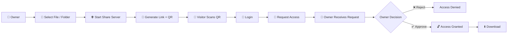

# 🔐 Sharo

### **Share files. Get permission. Stay connected.**

> A privacy-focused file sharing application that lets you share files and folders directly from your Android device — with **QR-based access, owner approval, and real-time chat**.

---

<p align="center">

**📁 Select → 🔗 Share → 📱 Scan → 🔐 Request → ✅ Approve → ⬇️ Download**

</p>

---

## 🌟 Why Sharo?

Most file-sharing applications focus on one simple thing:

> **"Here is the link. Download the file."**

Sharo takes a different approach.

Instead of giving anyone with a link immediate access, **the file owner remains in control**.

A person who receives your sharing link must first authenticate and **request permission**. The owner can then decide whether that person should be allowed to access the shared content.

And if they need to communicate, they can do it directly through the built-in **real-time chat**.

### 🛡️ Your file. Your decision. Your control.

---

# ✨ Key Features

| Feature                      | What it does                                                         |
| ---------------------------- | -------------------------------------------------------------------- |
| 📁 **File & Folder Sharing** | Share individual files or complete folders                           |
| 🌐 **Local Web Server**      | Turn your Android device into a temporary file server                |
| 🔗 **Instant Sharing Link**  | Generate a link that can be opened in any browser                    |
| 📷 **QR Code Sharing**       | Scan the QR code instead of typing long URLs                         |
| 🔐 **Login Protection**      | Users must authenticate before requesting access                     |
| 🙋 **Access Requests**       | Visitors explicitly request permission                               |
| ✅ **Owner Approval**         | The owner decides who can access the files                           |
| ❌ **Access Rejection**       | Requests can be denied at any time                                   |
| 💬 **Real-Time Chat**        | Owner and requester can communicate instantly                        |
| 🔔 **Live Notifications**    | Receive access requests and important updates instantly              |
| 📊 **Sharing Status**        | See active shares and pending requests                               |
| 📴 **Local Sharing**         | Files can be shared directly without uploading them to cloud storage |
| 🗃️ **Local Data**           | User and sharing information is maintained locally                   |

---

# 🚀 How Sharo Works



The entire experience is designed around one simple principle:

> **Having the link doesn't automatically mean having access.**

---

# 🔐 Permission-Based Sharing

This is the core idea behind Sharo.

When someone opens a shared link, they **cannot immediately download the file**.

Instead:

```text
                 🔗 Shared Link
                       │
                       ▼
                 🔐 User Login
                       │
                       ▼
                📄 File Details
                       │
                       ▼
                🙋 Request Access
                       │
                       ▼
              👤 Owner Gets Request
                       │
                 ┌─────┴─────┐
                 ▼           ▼
              ✅ Approve    ❌ Reject
                 │           │
                 ▼           ▼
           ⬇️ Download    🚫 Denied
```

### Why this matters

A shared URL can easily be forwarded to someone else.

With traditional link-based sharing:

```text
You → Link → Anyone with link → File
```

With Sharo:

```text
You → Link → Login → Request → Owner Approval → File
```

The owner remains in control even after the link has been shared.

---

# 👤 Access Request System

When a visitor wants to access a shared file, Sharo creates an access request.

The owner can see:

```text
┌─────────────────────────────────────┐
│          🔔 ACCESS REQUEST           │
├─────────────────────────────────────┤
│                                     │
│  👤 Rahul                           │
│                                     │
│  wants access to                    │
│  📁 Project.zip                     │
│                                     │
│  Requested: Just now                │
│                                     │
│  [ ❌ Reject ]    [ ✅ Approve ]    │
│                                     │
└─────────────────────────────────────┘
```

The owner decides whether access should be granted.

This makes Sharo especially useful when sharing files with:

* 👨‍💻 Team members
* 👩‍🎓 Classmates
* 🧑‍🤝‍🧑 Friends
* 🏢 Colleagues
* 📚 Project collaborators
* 👨‍🏫 Students and teachers

---

# 💬 Built-in Real-Time Chat

Sharing a file often creates a second problem:

> **"Can you approve my request?"**

Instead of switching to another messaging application, Sharo provides a built-in chat system.

```text
┌─────────────────────────────────────┐
│ 💬 Project.zip                      │
├─────────────────────────────────────┤
│                                     │
│ Rahul:                              │
│ Can you approve my request?         │
│                                     │
│ Pankaj:                             │
│ Sure, give me a moment.             │
│                                     │
│ Pankaj:                             │
│ Done ✅                             │
│                                     │
│ Rahul:                              │
│ Thanks!                             │
│                                     │
├─────────────────────────────────────┤
│ Type a message...             ➤    │
└─────────────────────────────────────┘
```

### ⚡ Real-time communication

Messages and important events can be delivered instantly.

For example:

```text
🙋 Access Request
        ↓
🔔 Owner Notification
        ↓
💬 Conversation
        ↓
✅ Approval
        ↓
🔓 Access Granted
        ↓
⬇️ Download
```

This makes communication part of the sharing experience instead of something separate.

---

# 📷 QR-Based Sharing

Long IP addresses and URLs are annoying to type.

Sharo solves this with a QR code.

The owner simply displays:

```text
        ┌─────────────────┐
        │                 │
        │    ▣ ▣ ▣ ▣      │
        │    ▣     ▣      │
        │    ▣ ▣ ▣ ▣      │
        │      ▣ ▣        │
        │    ▣     ▣      │
        │    ▣ ▣ ▣ ▣      │
        │                 │
        └─────────────────┘

     📱 Scan to access
```

The visitor scans the code and is taken directly to the sharing page.

No application installation is required on the receiving device — a normal web browser can be used.

---

# 📴 Direct & Local Sharing

One of Sharo's important goals is to keep the actual shared content **on the owner's device**.

Instead of:

```text
📱 Phone
   ↓
☁️ Upload
   ↓
🌐 Cloud
   ↓
📱 Download
```

Sharo can work like:

```text
📱 Owner Device
      │
      │ Direct connection
      ▼
💻 / 📱 Visitor
```

The Android device temporarily acts as the file server.

This can make Sharo useful for situations where users want to transfer files without first uploading them to a third-party cloud service.

---

# 🆚 What Makes Sharo Different?

Sharo isn't trying to compete simply by saying:

> **"We transfer files faster."**

Its main difference is the **permission and communication layer around file sharing**.

### Traditional link sharing

```text
Create Link
     ↓
Send Link
     ↓
Anyone with Link
     ↓
Download
```

### Sharo

```text
Create Share
     ↓
QR / Link
     ↓
User Login
     ↓
Access Request
     ↓
Owner Decision
     ↓
      ┌─────────────┐
      │             │
   ❌ Reject      ✅ Approve
      │             │
      ▼             ▼
   No Access     Download
                    │
                    ▼
               💬 Chat
```

### 🎯 The difference

| Traditional Sharing              | Sharo                                |
| -------------------------------- | ------------------------------------ |
| Link often acts as the key       | Link only starts the access process  |
| Little control after sharing     | Owner controls access                |
| Communication happens elsewhere  | Built-in chat                        |
| Usually upload/download workflow | Direct local sharing can be used     |
| QR may be an optional feature    | QR is part of the sharing experience |
| File sharing is the main focus   | Sharing + permission + communication |

---

# 🧠 Designed Around Privacy

Sharo follows a simple philosophy:

### **Access should be intentional.**

The application is designed so that:

* 🔐 Users authenticate before requesting access
* 🙋 Access must be requested
* 👤 The owner makes the final decision
* ❌ Requests can be rejected
* 🔓 Access is granted only after approval
* 💬 Users can communicate through the sharing session
* 📱 Shared files can remain on the owner's device
* 📴 Local sharing can work without cloud file storage

---

# 🗺️ User Journey

### 👤 Owner

```text
Open Sharo
   ↓
Select File / Folder
   ↓
Start Sharing
   ↓
QR + Link Generated
   ↓
Wait for Requests
   ↓
Receive Request
   ↓
Chat / Verify User
   ↓
Approve or Reject
   ↓
Manage Share
```

### 👥 Visitor

```text
Scan QR
   ↓
Open Browser
   ↓
Login / Register
   ↓
View Shared Content
   ↓
Request Access
   ↓
Wait for Owner
   ↓
Receive Approval
   ↓
Download
   ↓
Chat with Owner
```

---

# 📱 Core Screens

```text
┌───────────────┐    ┌────────────────┐    ┌────────────────┐
│   🏠 HOME     │    │  📁 SHARE      │    │  📷 QR CODE    │
│               │    │                │    │                │
│ My Shares     │ →  │ Select File    │ →  │   ▣ ▣ ▣ ▣      │
│               │    │ Select Folder  │    │   ▣     ▣      │
│ + New Share   │    │                │    │   ▣ ▣ ▣ ▣      │
└───────────────┘    └────────────────┘    └────────────────┘
                                                  │
                                                  ▼
┌───────────────┐    ┌────────────────┐    ┌────────────────┐
│ 💬 CHAT       │ ←  │ 🔔 REQUESTS    │ ←  │ 🌐 WEB PAGE    │
│               │    │                │    │                │
│ Hello!        │    │ Rahul          │    │ Login          │
│ Approved ✓    │    │ Project.zip    │    │ Request Access │
│               │    │ ❌   ✅         │    │                │
└───────────────┘    └────────────────┘    └────────────────┘
```

---

# 🔄 Sharing Lifecycle

Every share follows a controlled lifecycle:

```text
          🟢 ACTIVE
              │
              ▼
       🙋 REQUESTED
              │
        ┌─────┴─────┐
        ▼           ▼
     ❌ REJECTED   ✅ APPROVED
                      │
                      ▼
                  ⬇️ ACCESS
                      │
                      ▼
                  🔴 REVOKED
```

This gives the owner a clear understanding of what is happening with every shared resource.

---

# 🎯 Use Cases

### 🎓 Students

Share:

* Assignments
* Projects
* Presentations
* Notes
* Large datasets

without repeatedly uploading them to cloud storage.

### 👨‍💻 Developers

Share:

* Source-code archives
* Builds
* Test files
* Documentation
* Project resources

with controlled access.

### 🏠 Personal Sharing

Share:

* Photos
* Videos
* Documents
* Large folders

directly with people nearby.

### 🤝 Collaboration

Share project resources while using the integrated chat to communicate with collaborators.

---

# 🛠️ Project Goals

Sharo is designed around five principles:

```text
        🔐 SECURITY
            +
        ⚡ SIMPLICITY
            +
        📱 LOCAL CONTROL
            +
        💬 COMMUNICATION
            +
        👤 USER CONSENT
```

The goal isn't just to move a file from **A → B**.

The goal is to create a complete, controlled sharing experience:

> **Share → Identify → Request → Communicate → Approve → Access**

---

# 🚧 Project Status

🟡 **Currently in development**

Planned improvements include:

* [ ] Multiple simultaneous shares
* [ ] Share expiration
* [ ] Access revocation
* [ ] Download progress
* [ ] File previews
* [ ] Better folder browsing
* [ ] Share history
* [ ] Improved notifications
* [ ] Session management
* [ ] Advanced permission controls
* [ ] Improved transfer performance

---

# 🔮 Future Vision

Sharo can evolve beyond simple file transfer into a **private local collaboration platform**.

Future possibilities include:

```text
                 SHARO
                   │
       ┌───────────┼───────────┐
       ▼           ▼           ▼
    📁 Files    💬 Chat    👥 People
       │           │           │
       └───────────┼───────────┘
                   ▼
            🤝 Collaboration
```

The long-term vision is simple:

### **Make sharing more private, more controlled, and more human.**

---

# ❤️ Philosophy

> ### **A link should open a conversation, not automatically open your files.**

Sharo puts the **owner back in control** of the sharing process.

---

## 📄 License

This project is currently under development.

License information will be added as the project matures.

---

<p align="center">

### 🔐 Sharo

**Share files. Get permission. Stay connected.**

Made with ❤️ for private and controlled file sharing.

</p>
